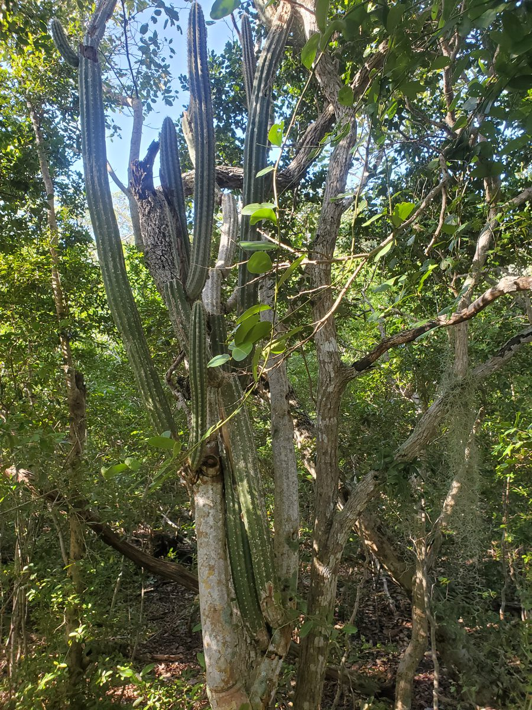
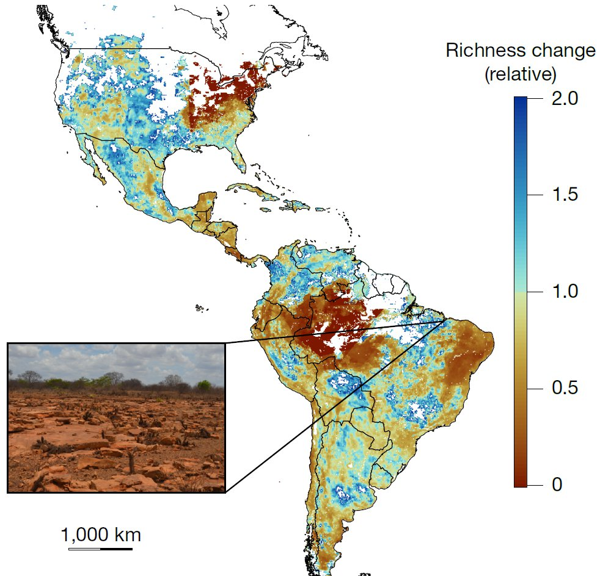

A new study led by lab postdoc [Mich Pillet](../people.qmd#michiel-mich-pillet), with Brian Maitner and colleagues, is now out in *Nature*: [Severe drought and warming increase the extinction risk of cacti](https://doi.org/10.1038/s41586-026-11265-1).

{fig-alt="Tall columnar Key tree cactus growing among trees in a Florida Keys hammock" width=70% fig-align="center"}

Most forecasts of how species will fare under climate change rely on long-term climate averages and leave out extreme events. Cacti are often seen as drought tolerant, but at least 30% of species are already at risk of extinction. The team combined new global data on future severe droughts with nearly 650,000 cactus occurrence records to model 993 cactus species. Models that included severe drought were better supported in 91% of cases, and they changed the picture considerably:

- The share of species projected to lose suitable climatic area rose from 58–61% to 69–72%.
- The share projected to lose more than four-fifths of their suitable area rose from 1–15% to 25–35%.
- If species cannot disperse to new areas, 84–85% are projected to lose suitable area.

The results show that leaving out climate extremes can understate how vulnerable biodiversity is to climate change.

{fig-alt="Map of the Americas colored by projected relative change in cactus species richness, with losses in brown and gains in blue, and an inset photo of a dry, rocky landscape" fig-align="center"}

**Coverage**

- [Nature Research Briefing: Cacti are severely threatened by drought in a warming world](https://www.nature.com/articles/d41586-026-03496-z)
- [Nature Podcast: Too dry for cacti](https://www.nature.com/articles/d41586-026-03671-2)
- [Phys.org](https://phys.org/news/2026-11-cacti-severely-threatened-warmer-drier.html)
- [EurekAlert](https://www.eurekalert.org/news-releases/1151086)
